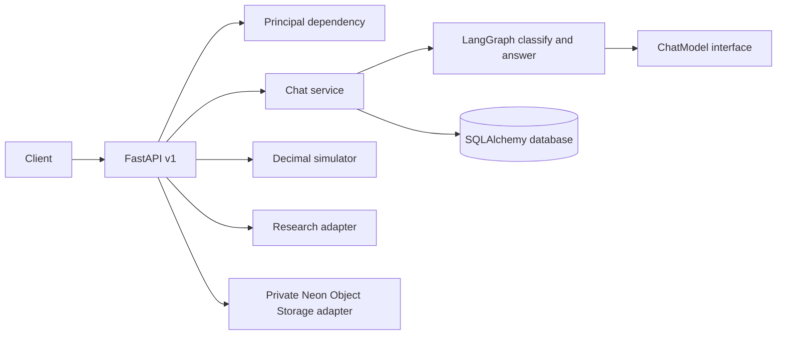

# Architecture and baseline

## Baseline

The initial Git checkout contained no application source, tests, dependencies, migrations or docs. There was no existing simulator or API behavior to preserve. This implementation establishes a modular monolith.

Routes validate and authorize requests; service code owns conversation persistence; the LangGraph nodes classify task intent and invoke the configured model; simulation is deterministic Python and does not involve the model. SQLAlchemy models have `user_id` ownership and all user-scoped reads filter against the authenticated principal.

The follow-through layer persists memory policies, local memories, projects, tasks, reminders, jobs, in-app notifications, approvals, audit events and idempotency keys. A database polling worker processes due reminders outside chat. It writes in-app notifications only; external notification delivery and generic protected-action execution are not implemented.

## Decisions and limitations

- SQLite enables offline local use; Postgres is the deployment target. pgvector extension is provisioned in Compose but vectors are not persisted to pgvector yet.
- LangGraph is the request orchestrator. State is typed but graph checkpoints are not durable; user-visible messages persist in SQL.
- The default mock provider avoids credentials and makes local API behavior deterministic.
- File upload presigning is implemented for Neon Object Storage; upload completion currently records metadata only. Extraction, chunk persistence, signed downloads and object deletion are not implemented.
- Redis/QStash, LangSmith, Langfuse runtime tracing, Better Auth/Neon Managed Auth, and NeMo Agent Toolkit have configuration placeholders or are not implemented. They are not represented as production integrations.
- Simulation currently covers recurring income/expenses and one-time/monthly changes. Monte Carlo, sensitivity, breakpoint search, goals/commitments, branches and saved runs remain unfinished.
