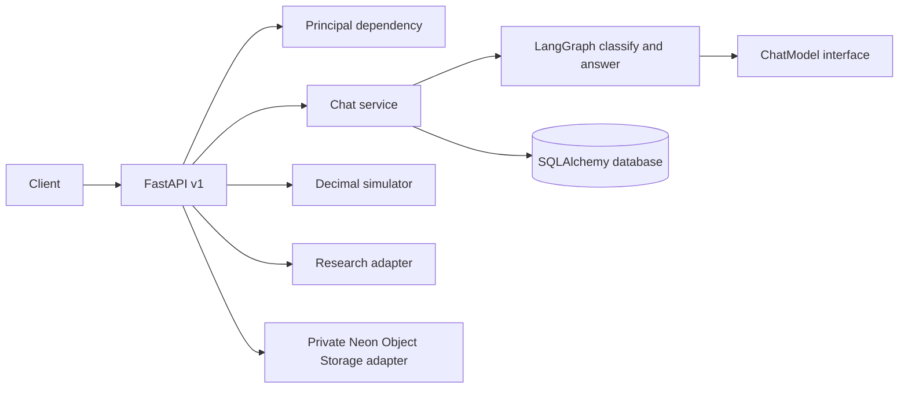

# Architecture and baseline

## Baseline

The initial Git checkout contained no application source, tests, dependencies, migrations or docs. There was no existing simulator or API behavior to preserve. This implementation establishes a modular monolith.

Routes validate and authorize requests; service code owns conversation persistence; the LangGraph nodes classify task intent and invoke the configured model; simulation is deterministic Python and does not involve the model. SQLAlchemy models have `user_id` ownership and all user-scoped reads filter against the authenticated principal.

The follow-through layer persists memory policies, approved local memories, reviewable memory candidates, projects, tasks, reminders, jobs, in-app notifications, approvals, audit events and idempotency keys. Explicit "remember" requests are saved automatically only when the user's policy permits that nonsensitive category; otherwise they wait for approval. Chat retrieves approved memories across conversations using lexical overlap. A database polling worker uses conditional claims, stale-lease recovery and bounded retries. It writes in-app notifications only. The approval executor supports validated local task/reminder creation and exact-snapshot Gmail draft sending; purchase, deletion, and Calendar event writes have no executor.

## Decisions and limitations

- SQLite enables offline local use; PostgreSQL is the durable deployment target. pgvector is present in the Compose image but no vectors are persisted to it.
- LangGraph is the request orchestrator. State is typed but graph checkpoints are not durable; user-visible messages persist in SQL.
- The default mock provider avoids credentials and makes local API behavior deterministic.
- Projects, tasks and reminders are structured SQL records. Reminders support one-time, daily and weekly in-app delivery; no email or push channel is configured.
- File upload presigning is implemented for Neon Object Storage; upload completion currently records metadata only. Extraction, chunk persistence, signed downloads and object deletion are not implemented.
- Redis/QStash, LangSmith, Langfuse runtime tracing, Better Auth/Neon Managed Auth, and NeMo Agent Toolkit have configuration placeholders or are not implemented. They are not represented as production integrations.
- Simulation currently covers recurring income/expenses and one-time/monthly changes. Monte Carlo, sensitivity, breakpoint search, goals/commitments, branches and saved runs remain unfinished.

## Tool ecosystem and Google connections

Tool definitions live in `app/tools`; the catalog provides model-visible schemas and the conversation executor validates registered names and arguments before dispatch. Research and Google tools share this execution path. Google OAuth state is random, stored as a hash, expires after ten minutes, and is consumed before code exchange. Tokens are encrypted before persistence.

Gmail draft sending is now available only as an approval proposal when the user granted the separate `gmail.send` scope. The action executor verifies the draft snapshot again after approval, records the provider message ID on success, and marks ambiguous network outcomes `uncertain` without retrying. Calendar writes remain unavailable.
# Capability catalogue and execution

Model-callable operations are registered in `app/tools/registry.py`, with built-ins declared in `app/tools/catalog.py`. The same definitions provide model function schemas and sanitized UI metadata from `GET /api/v1/plugins`. The catalogue is owner-aware for Google connection scopes but deliberately does not represent configuration or connection state as proof of provider health.

The conversation graph selects relevant tools using the current request, filters out Google tools without the owner's granted scopes, validates model arguments, and dispatches through `execute_tools`. The tool-call loop is limited to two rounds. Google API helpers revalidate the owner-scoped connected account and scopes during execution. Gmail sends use the existing approval record and exact draft snapshot. Tool execution summaries are exposed only to the authenticated owner through `/api/v1/plugins/executions`.

Provider-specific execution branches remain in the graph today; the registry does not by itself make a tool executable. Async provider and follow-through operations run under their registered timeout and are cancelled on expiry; synchronous local arithmetic is bounded by its input validation. Generic adapter lifecycle and live provider health checks remain future work. See [plugin-audit.md](plugin-audit.md).
