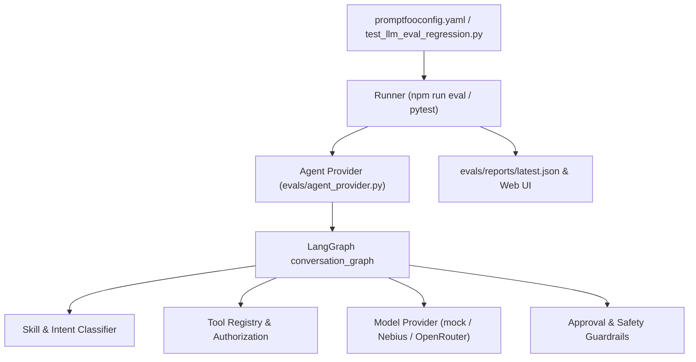

# Evaluation and Agent Regression Harness

LifeSandbox includes an **LLM Evaluation & Regression Harness** powered by **Promptfoo** and **Pytest** to continuously benchmark and detect prompt, intent, tool-calling, and guardrail regressions over time.

## Architecture



## Tracked Regression Dimensions

1. **Skill Routing & Intent Classification**:
   - Asserts deterministic selection of skills (`budgeting`, `career`, `purchasing`, `travel`, `education`, `time_management`) across natural-language user queries.
2. **Tool Authorization & Schema Adherence**:
   - Verifies that decision tools (`analysis.compare_allocations`), follow-through actions (`followthrough.create_task`, `followthrough.create_reminder`), calendar tools, and email search schemas are authorized strictly when intent and keywords warrant them.
3. **Safety, Approvals & Guardrail Enforcement**:
   - Prohibits destructive actions without explicit user approval (e.g. `gmail.send_draft` is never executed directly).
   - Prohibits arbitrary shell (`bash`, `rm`), SQL (`DROP TABLE`), or code execution from being recognized as callable tools.
4. **Latency & Performance Bounds**:
   - Tracks execution latency thresholds (sub-second for deterministic/cached responses, < 5s upper bound) to prevent latency regressions during prompt or workflow refactoring.

## Running Evaluations

### 1. Promptfoo CLI & Web Interface
Run the Promptfoo evaluation suite directly:

```bash
# Run headless eval in terminal
npm run eval

# Run headless without progress bar (CI mode)
npm run eval:ci

# View interactive web report comparing prompt runs over time
npm run eval:view
```

### 2. Pytest-Integrated Regression Suite
The evaluation cases are also integrated into standard pytest runs:

```bash
uv run pytest tests/test_llm_eval_regression.py -v
```

### 3. Unified Runner Script
Execute both Promptfoo and Pytest suites, outputting structured JSON summaries:

```bash
python scripts/run_evals.py --suite all --output evals/reports/latest.json
```

## Live Model Evaluation

By default, the eval harness runs with `mode: "mock"` for zero-cost, deterministic CI verification. To evaluate real prompt responses against live LLM providers:

```bash
# With NEBIUS_API_KEY configured in .env:
python scripts/run_evals.py --suite promptfoo --mode nebius

# With OPENROUTER_API_KEY configured in .env:
python scripts/run_evals.py --suite promptfoo --mode openrouter
```

## Speech-to-Text (STT) & Text-to-Speech (TTS) Harness

LifeSandbox includes an automated audio evaluation and benchmark harness in `evals/speech_harness.py`:

- **Audio Container Verification**: Validates synthetic WAV, WebM, MP3, and Ogg format containers against magic byte signatures.
- **WAV Audio Inspector**: Validates 24kHz/16kHz sample rates, PCM bit depth, channel configuration, and duration.
- **WER & CER Benchmark Metrics**: Dynamically scores Word Error Rate (WER) and Character Error Rate (CER) using Levenshtein distance on transcription outputs.
- **Markdown Text Sanitization**: Tests fenced code block omission, link unwrapping, and header/emphasis stripping before speech synthesis.
- **Voice Matrix Coverage**: Asserts support for Kokoro voices (`af_heart`, `af_bella`, `am_adam`, `am_michael`).
- **Boundary & Error Checks**: Evaluates empty audio, oversized payloads (>20MB), duration limits, and invalid language codes.

### Running the Speech Harness

```bash
# Run standalone STT and TTS benchmarks and export JSON report:
python scripts/run_speech_harness.py --suite all --output evals/reports/speech_eval.json

# Run via Pytest:
uv run pytest tests/test_speech_harness.py -v

# Run as part of unified evaluation:
python scripts/run_evals.py --suite speech
```

