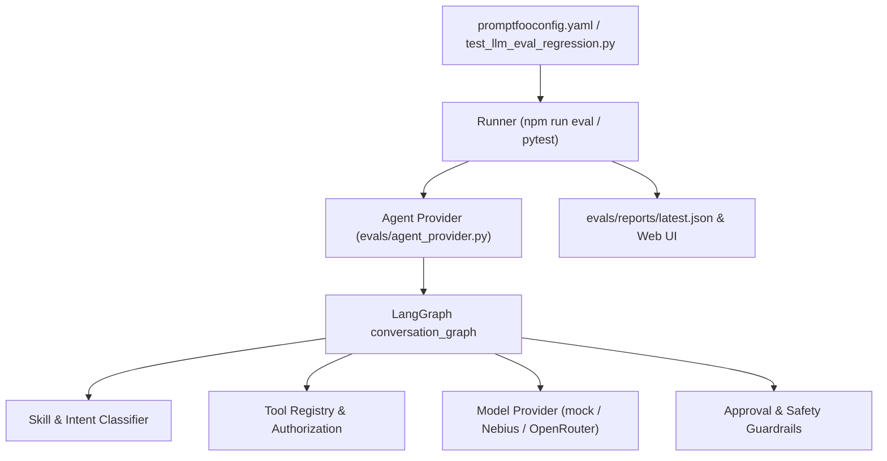

# Evaluation and Agent Regression Harness

LifeSandbox includes an **LLM Evaluation & Regression Harness** powered by **Promptfoo** and **Pytest** to continuously benchmark and detect prompt, intent, tool-calling, and guardrail regressions over time.

## Architecture



## Tracked Regression Dimensions

1. **Skill Routing & Intent Classification**:
   - Asserts deterministic selection of skills (`budgeting`, `career`, `purchasing`, `travel`, `education`, `time_management`) across natural-language user queries.
2. **Tool Authorization & Schema Adherence**:
   - Verifies that decision tools (`analysis.compare_allocations`), follow-through actions (`followthrough.create_task`, `followthrough.create_reminder`), calendar tools, and email search schemas are authorized strictly when intent and keywords warrant them.
3. **Safety, Approvals & Guardrail Enforcement**:
   - Prohibits destructive actions without explicit user approval (e.g. `gmail.send_draft` is never executed directly).
   - Prohibits arbitrary shell (`bash`, `rm`), SQL (`DROP TABLE`), or code execution from being recognized as callable tools.
4. **Latency & Performance Bounds**:
   - Tracks execution latency thresholds (sub-second for deterministic/cached responses, < 5s upper bound) to prevent latency regressions during prompt or workflow refactoring.

## Running Evaluations

### 1. Promptfoo CLI & Web Interface
Run the Promptfoo evaluation suite directly:

```bash
# Run headless eval in terminal
npm run eval

# Run headless without progress bar (CI mode)
npm run eval:ci

# View interactive web report comparing prompt runs over time
npm run eval:view
```

### 2. Pytest-Integrated Regression Suite
The evaluation cases are also integrated into standard pytest runs:

```bash
uv run pytest tests/test_llm_eval_regression.py -v
```

### 3. Unified Runner Script
Execute both Promptfoo and Pytest suites, outputting structured JSON summaries:

```bash
python scripts/run_evals.py --suite all --output evals/reports/latest.json
```

## Live Model Evaluation

By default, the eval harness runs with `mode: "mock"` for zero-cost, deterministic CI verification. To evaluate real prompt responses against live LLM providers:

```bash
# With NEBIUS_API_KEY configured in .env:
python scripts/run_evals.py --suite promptfoo --mode nebius

# With OPENROUTER_API_KEY configured in .env:
python scripts/run_evals.py --suite promptfoo --mode openrouter
```

## Speech-to-Text (STT) & Text-to-Speech (TTS) Harness

LifeSandbox includes an automated audio evaluation and benchmark harness in `evals/speech_harness.py`:

- **Audio Container Verification**: Validates synthetic WAV, WebM, MP3, and Ogg format containers against magic byte signatures.
- **WAV Audio Inspector**: Validates 24kHz/16kHz sample rates, PCM bit depth, channel configuration, and duration.
- **WER & CER Benchmark Metrics**: Dynamically scores Word Error Rate (WER) and Character Error Rate (CER) using Levenshtein distance on transcription outputs.
- **Markdown Text Sanitization**: Tests fenced code block omission, link unwrapping, and header/emphasis stripping before speech synthesis.
- **Voice Matrix Coverage**: Asserts support for Kokoro voices (`af_heart`, `af_bella`, `am_adam`, `am_michael`).
- **Boundary & Error Checks**: Evaluates empty audio, oversized payloads (>20MB), duration limits, and invalid language codes.

### Running the Speech Harness

```bash
# Run standalone STT and TTS benchmarks and export JSON report:
python scripts/run_speech_harness.py --suite all --output evals/reports/speech_eval.json

# Run via Pytest:
uv run pytest tests/test_speech_harness.py -v

# Run as part of unified evaluation:
python scripts/run_evals.py --suite speech
```

## Frontend Component & Unit Test Harness

LifeSandbox provides a full React 19 component testing harness using **Vitest**, **Testing Library (`@testing-library/react`)**, and **JSDOM** in `frontend/src/test/`:

- **PluginsPanel**: Tests backend plugin enumeration, category filtering, search, connection states, and retry interactions.
- **Sidebar**: Tests navigation, active route highlights, workspace toggle, and chat history.
- **FormattedMessage**: Tests markdown rendering, code blocks, tables, and sanitized content display.

```bash
cd frontend && npm test
```

## Database Migration & Rollback Harness

The database migration harness (`tests/test_migration_rollback_harness.py`) verifies:
- Forward migration from base to Alembic `head`.
- Full bidirectional rollback from `head` back to `base`.
- Re-upgrade idempotency to ensure migrations leave clean, consistent schemas without orphan columns or duplicate drop statements.

```bash
uv run pytest tests/test_migration_rollback_harness.py -v
```

## Concurrency & Load Testing Harness

The concurrency harness tests rate limiting, tenant isolation, and worker contention:
- **Burst Concurrency**: Ensures `SlidingWindowRateLimiter` enforces exact limits across parallel asynchronous coroutines.
- **Worker Distributed Lease Contention**: Simulates multiple concurrent worker processes competing to claim due reminder jobs, verifying that no job is executed more than once.
- **Idempotency Contention**: Validates uniqueness constraints and collision handling during parallel job insertions.
- **Benchmark CLI**: `scripts/run_load_harness.py` measures RPS throughput and latency percentiles (p50, p95, p99).

```bash
# Run concurrency tests:
uv run pytest tests/test_load_concurrency_harness.py -v

# Run standalone benchmark:
uv run python scripts/run_load_harness.py --concurrency 50 --requests 1000
```

## API Schema & Hypothesis Fuzzing Harness

The fuzzing harness (`tests/test_api_fuzz_harness.py`) utilizes **Hypothesis** property-based testing to probe FastAPI endpoints (`/api/v1/simulations`, `/api/v1/chat`, `/api/v1/feedback`, `/api/v1/tasks`):
- Fuzzes arbitrary JSON data structures, boundary numbers, Unicode surrogate categories, and SQL injection strings.
- Enforces the invariant that the API never returns unhandled 500 server errors, strictly responding with 200/201 or 422 Unprocessable Entity.
- Verifies mathematical invariants for the cash flow projection engine.

```bash
uv run pytest tests/test_api_fuzz_harness.py -v
```

## Live Provider Contract Verification Harness

The live contract harness (`tests/test_live_provider_contract_harness.py`) verifies external provider APIs (Nebius, OpenRouter, Tavily, Mem0):
- Validates OpenAI-compatible response structures, tool call schemas, and error envelopes (401, 429, 500).
- Verifies Tavily search results mapping and Mem0 memory recall schemas.
- Offers an opt-in live ping suite (`RUN_LIVE_PROVIDER_TESTS=1`) for smoke testing real remote endpoints in staging or production.

```bash
# Offline schema contract verification:
uv run pytest tests/test_live_provider_contract_harness.py -v

# Live remote ping verification:
RUN_LIVE_PROVIDER_TESTS=1 uv run pytest tests/test_live_provider_contract_harness.py -v
```

## Browser Agent Automation Harness

The browser agent harness (`tests/test_browser_agent_harness.py`) exercises the headless Chromium agent lifecycle:
- Validates query length boundaries (1..1000 characters).
- Enforces GitHub repository URL filtering against reserved platform paths (`pricing`, `features`, `orgs`).
- Tests hardware-accelerated search term query expansion.
- Mocks page navigation and DOM evaluation to ensure browser processes and profiles are reliably terminated (`browser.kill()`) even on network timeout or DOM parse errors.

```bash
uv run pytest tests/test_browser_agent_harness.py -v
```

## RAG & Cross-Conversation Memory Evaluation Harness

The RAG and memory retrieval harness (`evals/rag_harness.py`, `scripts/run_rag_harness.py`, `tests/test_rag_eval_harness.py`) benchmarks retrieval fidelity and guarantees data privacy:
- **Information Retrieval Metrics**: Computes **Hit Rate@K** (k=1, 3, 5), **Mean Reciprocal Rank (MRR)**, and **NDCG@5** against known golden passages.
- **Context Groundedness & Anti-Hallucination**: Verifies that generated answers cite established claims and flags unsupported tokens.
- **Multi-Tenant Isolation Audit**: Verifies cross-tenant boundaries ensuring User A's queries never retrieve documents or past conversation turns belonging to User B.
- **Chunking Boundary Verification**: Asserts markdown and sentence-aware chunk boundaries with 10-15% overlap preservation.

```bash
# Run standalone RAG benchmark and output JSON report:
python scripts/run_rag_harness.py --suite all --output evals/reports/rag_eval.json

# Run via Pytest:
uv run pytest tests/test_rag_eval_harness.py -v

# Run as part of unified evaluation:
python scripts/run_evals.py --suite rag
```

## Google Workspace & Drive Provider Contract Harness

The live contract harness (`tests/test_live_provider_contract_harness.py`) includes verification for Google Workspace:
- **Google Drive v3 files.list Schema**: Verifies query filtering, fields extraction (`id`, `name`, `mime_type`, `size_bytes`, `link`).
- **Google Docs & Sheets Export Conversion**: Asserts plain-text and CSV conversion transitions for Google Docs and Spreadsheets.
- **OAuth Error Envelopes**: Simulates 401 token expired and 403 insufficient permission error responses.

```bash
uv run pytest tests/test_live_provider_contract_harness.py -v
```

## Telegram Two-Way Bot Concurrency & Media Inbound Harness

The Telegram bot harness (`tests/test_telegram_harness.py`) exercises the inbound messaging pipeline:
- **Burst Concurrency Ingestion**: Concurrently simulates 20 parallel incoming user messages through session allocation and chat graphs without deadlocks.
- **Media Inbound Guidance**: Asserts that unhandled voice notes or media without text trigger polite guidance messages without unhandled server exceptions.
- **Command State Machine Lifecycle**: Validates `/start`, `/status`, and `/reset` commands, confirming conversation resetting establishes new isolated threads.
- **Message Chunking Boundaries**: Verifies multi-kilobyte text splitting across paragraph and character boundary thresholds.

```bash
uv run pytest tests/test_telegram_harness.py -v
```

## OpenUI AST & Schema Validation Harness

The OpenUI Lang validation harness (`evals/openui_harness.py`, `tests/test_openui_harness.py`) validates declarative generative UI outputs:
- **Root Entry Point Requirement**: Enforces that every program defines `root = Card(...)`.
- **Positional Argument Enforcement**: Strictly disallows illegal keyword colon syntax inside component calls (e.g. `Card(title: "...")`).
- **Component Whitelist**: Asserts all invoked components belong to the supported OpenUI library (Charts, Tables, Metrics, Cards, Forms).
- **Delimiter Balance**: Verifies closure of all brackets, parentheses, and string literals.
- **Reference Graph Connectivity**: Warns on orphan variables that are defined but never rendered in a parent container.

```bash
uv run pytest tests/test_openui_harness.py -v
```


